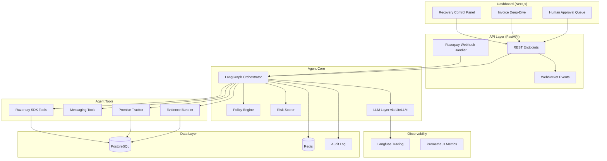
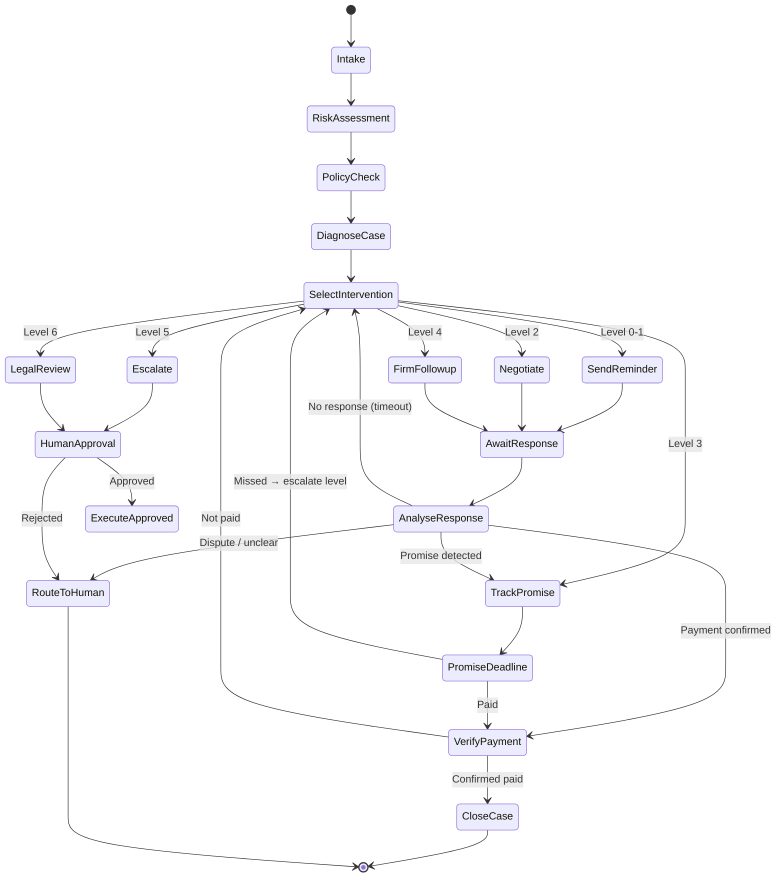
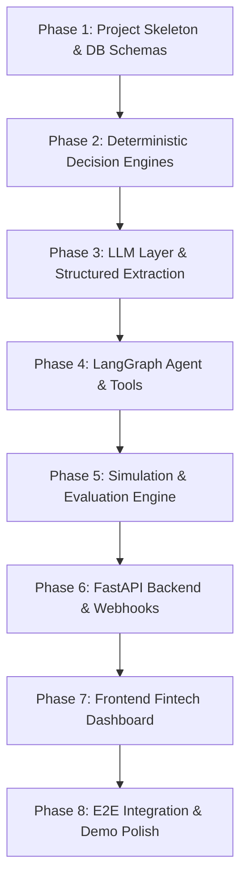

# RevBack — AI Revenue Recovery & Escalation Agent

## Razorpay Buildathon 2026 · Track 3: AI Revenue Recovery

An autonomous revenue-recovery agent that detects at-risk B2B receivables, diagnoses causes, selects interventions, tracks commitments, verifies recovery, and escalates persistent defaults — with a complete audit trail and measured financial outcomes.

---

## Judging Criteria Alignment

The buildathon evaluates on **4 axes**. Every architectural decision below maps to at least one:

| Criterion | How We Score |
|---|---|
| **Problem Taste** | B2B receivables is a ₹multi-lakh real pain point for every Razorpay merchant; we don't just remind — we *recover* |
| **Build Quality** | Production-grade Python monorepo, typed schemas, deterministic policy engine, comprehensive tests |
| **AI Judgment** | LLM only where it excels (NLU, generation, summarisation); all arithmetic, policy, and state via deterministic code |
| **Failure Recovery** | Graceful degradation at every boundary — disputed invoices, API failures, unparseable responses, legal uncertainty |

---

## Proposed Architecture



---

## Tech Stack

| Layer | Technology | Rationale |
|---|---|---|
| **Agent Framework** | **LangGraph** (Python) | Graph-based state machine with built-in persistence, human-in-the-loop interrupts, and cycle support. Production-grade for stateful multi-step workflows |
| **LLM Gateway** | **LiteLLM** | Unified interface to 140+ providers, model routing (use Flash for classification, Sonnet/GPT-4o for generation), cost tracking, automatic fallbacks |
| **Structured Extraction** | **Instructor** + Pydantic | Type-safe promise extraction, intent classification, response parsing with automatic retry on validation failure |
| **Observability** | **Langfuse** (self-hosted) | Per-trace token/cost tracking, prompt versioning, evaluation datasets — integrates natively with LiteLLM |
| **Backend API** | **FastAPI** | Async, typed, OpenAPI docs out of the box, WebSocket support for real-time dashboard updates |
| **Task Queue** | **Celery** + **Redis** | Scheduled follow-ups, promise deadline checks, batch processing. Redis also serves as LangGraph checkpointer |
| **Database** | **PostgreSQL** | Structured invoice/customer/promise/audit data with JSONB for flexible metadata |
| **Payments** | **Razorpay Python SDK** | Invoices API, Payment Links API, Customers API, Webhooks — native integration with the platform we're building for |
| **Frontend** | **Next.js 15** (App Router) + **Tailwind CSS** + **shadcn/ui** + **Tremor** | Enterprise fintech UI (Mercury/Stripe/RazorpayX aesthetic). Zero neon. Reusable components from shadcn/ui + Tremor for financial cards/charts, Framer Motion for ultra-light 60fps micro-animations |
| **Component Registries** | **shadcn/ui**, **Tremor Raw**, **Magic UI** | Off-the-shelf production components (Radix primitives, financial KPI sparklines, data tables, animated number tickers) rather than hand-crafting low-level widgets |
| **Deployment** | **Docker Compose** | Single `docker compose up` for the entire stack (API, worker, Redis, Postgres, Langfuse) |

---

## Razorpay API Integration Map

Every Razorpay API we use, and where it fits:

| Razorpay API | Endpoint | Use in RevBack |
|---|---|---|
| **Invoices API** | `POST /v1/invoices` | Create invoices for the synthetic dataset; fetch invoice status |
| **Invoices — Fetch** | `GET /v1/invoices/{id}` | Check if invoice has been paid (verification step) |
| **Payment Links** | `POST /v1/payment_links` | Agent sends personalised payment links with `notify.sms` and `notify.email` |
| **Customers API** | `GET /v1/customers/{id}` | Fetch customer metadata for risk scoring |
| **Payments API** | `GET /v1/payments/{id}` | Verify payment capture after promise deadline |
| **Webhooks** | `payment_link.paid`, `invoice.paid`, `payment.captured` | Real-time payment verification — closes the recovery loop automatically |
| **Items API** | `POST /v1/items` | Create line items for invoices in the synthetic dataset |

---

## Open-Source Tools & Cost Optimisation

### Token Cost Reduction Strategy (Target: 60–70% savings)

| Strategy | Tool / Technique | Impact |
|---|---|---|
| **Intelligent Model Routing** | LiteLLM Router | Route classification/extraction to `gemini-2.0-flash` (~$0.10/1M tokens), use `gpt-4o` / `claude-sonnet` only for complex generation. **~50% cost reduction** |
| **Prompt Caching** | LiteLLM + provider-native caching | System prompts and policy context are stable — cache at provider level. **~30% reduction on cached segments** |
| **Structured Output** | Instructor + Pydantic | Eliminates re-prompting for malformed JSON. Automatic retry with validation error feedback. **~15% fewer wasted calls** |
| **Semantic Caching** | Redis-based similarity cache | Similar customer scenarios get cached responses for classification. **~20% fewer LLM calls** |
| **Context Trimming** | Rolling window on conversation history | Only last N relevant interactions sent to LLM, not full history. **~40% input token reduction** |
| **Observability** | Langfuse | Track cost per invoice, per customer, per agent action — identify and eliminate waste |

### Key Open-Source Repos — Critical Audit

> [!IMPORTANT]
> Every dependency must earn its place. Below is an honest evaluation of each tool against our **actual hackathon constraints**: tight deadline, synthetic data, demo-focused scope. Tools that add integration overhead without visible demo value are cut.

#### ✅ ADOPTED — Genuinely Load-Bearing

| Repo / Tool | Role in RevBack | Why It Earns Its Place |
|---|---|---|
| **[langchain-ai/langgraph](https://github.com/langchain-ai/langgraph)** | Agent state machine & orchestrator | The entire recovery workflow (intake → diagnose → act → observe → adapt) is a stateful graph with cycles. LangGraph gives us persistence (Redis checkpointer), human-in-the-loop interrupts at escalation nodes, and step-limit guardrails — all out of the box. This is the backbone. |
| **[BerriAI/litellm](https://github.com/BerriAI/litellm)** | LLM gateway, model routing, cost tracking | Routes cheap calls (classification/extraction) to Gemini Flash, expensive calls (legal drafts) to Claude Sonnet — via a single `completion()` interface. Built-in spend tracking per key. Failover if a provider 503s. We need this for cost optimisation and resilience. |
| **[jxnl/instructor](https://github.com/jxnl/instructor)** | Structured extraction with Pydantic | Promise-to-pay extraction is the killer feature. Instructor guarantees we get `{amount, date, confidence}` back from the LLM, not free-form text. Auto-retries on validation failure. Without this, every extraction is fragile and needs manual JSON parsing. |
| **[langfuse/langfuse](https://github.com/langfuse/langfuse)** | LLM observability & cost attribution | We're building a **Cost-per-Recovery Dashboard** (Feature 6). Langfuse gives us per-trace token/cost attribution that flows directly into that feature. Also critical for debugging agent reasoning during development. |
| **[razorpay/razorpay-python](https://github.com/razorpay/razorpay-python)** | Razorpay SDK | Non-negotiable — this is a Razorpay hackathon. Invoices API, Payment Links API, Customers API, webhook signature verification. |
| **[Headroom](https://github.com/headroomlabs-ai/headroom)** | Context compression before LLM calls | **Kept with a narrow scope.** We use it as a Python library (not proxy mode) to compress conversation histories before they hit the LLM. With 7 intervention levels and multi-turn debtor conversations, context windows fill up fast even with synthetic data. The CCR mechanism is reversible — if the LLM needs exact quotes for promise extraction, Headroom retrieves the uncompressed slice. Integrates in ~20 lines via the SDK. |
| **[deeplethe/utopia](https://github.com/deeplethe/utopia)** | Bitemporal promise & commitment timeline | **Kept — but as a design pattern, not a hard dependency.** The bitemporal concept (valid time vs. transaction time) is genuinely powerful for legal evidence bundles: *"Customer promised ₹4.5L on Aug 10, system recorded at Aug 10 14:32, promise expired Aug 20, system marked MISSED at Aug 20 00:05."* We implement this as two timestamp columns (`valid_at`, `recorded_at`) on our Promise and Intervention SQLAlchemy models, inspired by utopia's architecture but without importing a Rust binary. If time permits, we can swap in utopia as the backing store. |

#### ❌ CUT — Deadweight for This Scope

| Repo / Tool | Why It Was Considered | Why It's Cut |
|---|---|---|
| **[LightRAG](https://github.com/HKUDS/LightRAG)** (HKUDS) | Graph-enhanced RAG for evidence bundling | **Our data is structured SQL, not unstructured documents.** LightRAG excels at building knowledge graphs from PDFs, emails, and wikis. But our invoices, customers, promises, and communications are already in normalised PostgreSQL tables with foreign keys. The "entity-relationship graph" already exists — it's our database schema. Evidence bundling is just SQL joins + LLM summarisation. Adding LightRAG would mean duplicating our structured data into a vector/KG store for zero retrieval benefit. |
| **[OpenConnector](https://github.com/oomol-lab/open-connector)** (OOMOL) | Secure auth gateway for multi-channel outreach | **We're simulating communications in the hackathon, not sending real emails.** Our synthetic dataset generates mock customer responses. Multi-channel outreach (Feature 4) is implemented as channel-tagged records in the CommunicationLog, not real API calls to Gmail/Slack/WhatsApp. Adding a full MCP auth gateway for simulated sends is pure overhead. In production, OpenConnector would be valuable — but for the demo, it's deadweight. |
| **[Busbar](https://github.com/GetBusbar/busbar)** | Rust AI control plane with failover | **Directly duplicates LiteLLM.** Both provide model routing, failover, load balancing, and credential management. LiteLLM is already in our stack, has native Langfuse integration, and is Python-native (no Rust binary to manage). Running both is redundant. LiteLLM wins because it's already wired into our Instructor + Langfuse pipeline. |

---

### Final Architecture (Post-Audit)

```text
┌────────────────────────────────────────────────────────────────────────┐
│   DASHBOARD (Next.js 15 / shadcn / Tremor / Framer Motion)            │
└───────────────────────────────────┬────────────────────────────────────┘
                                    │
                                    ▼
┌────────────────────────────────────────────────────────────────────────┐
│                    FASTAPI + CELERY WORKERS                            │
│  REST API · WebSocket events · Razorpay Webhook handler                │
└───────────────────────────────────┬────────────────────────────────────┘
                                    │
                                    ▼
┌────────────────────────────────────────────────────────────────────────┐
│              LANGGRAPH AGENT ORCHESTRATOR                              │
│  State machine · Redis checkpointing · Human-in-the-loop interrupts   │
│  Deterministic Policy Engine · Risk Scorer · Tone Adapter              │
│  Confidence Gating · Recovery Probability · Send-Time Optimizer        │
│  Bitemporal Promise Tracking (utopia-inspired schema)                  │
└───────────────┬───────────────────────────────────────┬────────────────┘
                │                                       │
                ▼                                       ▼
┌────────────────────────────────┐   ┌───────────────────────────────────┐
│        TOOL LAYER              │   │     LLM OPTIMISATION PIPELINE     │
│  Razorpay SDK:                 │   │  1. Headroom SDK: context         │
│   Invoices, Payment Links,     │   │     compression (CCR)             │
│   Customers, Webhooks          │   │  2. Instructor: Pydantic-typed    │
│  Payment Plan Generator        │   │     structured extraction         │
│  Evidence Bundler              │   │  3. LiteLLM: model routing &      │
│  Multi-Channel Dispatcher      │   │     failover (Flash/Sonnet/GPT)   │
│  Send-Time Scheduler           │   │  4. Langfuse: per-token cost      │
│                                │   │     attribution & tracing         │
└────────────────────────────────┘   └───────────────────────────────────┘
                │                                       │
                ▼                                       ▼
┌────────────────────────────────┐   ┌───────────────────────────────────┐
│  PostgreSQL (bitemporal schema │   │  [Gemini Flash / GPT-4o /         │
│  + audit log + JSONB metadata) │   │   Claude Sonnet]                  │
│  Redis (checkpoints + cache)   │   │                                   │
└────────────────────────────────┘   └───────────────────────────────────┘
```

---

## Proposed Changes

### Component 1: Project Foundation & Configuration

#### [NEW] [`pyproject.toml`](file:///Users/ashmit/Downloads/RevBack/pyproject.toml)
Project metadata, dependencies, and tool configuration. Key dependencies:
- `langgraph`, `langchain-core` — agent orchestration
- `litellm` — LLM gateway
- `instructor` — structured extraction
- `fastapi`, `uvicorn` — API server
- `celery[redis]` — task queue
- `razorpay` — Razorpay SDK
- `sqlalchemy`, `asyncpg`, `alembic` — database
- `langfuse` — observability
- `pydantic>=2.0` — data validation
- `pytest`, `pytest-asyncio` — testing

#### [NEW] [`docker-compose.yml`](file:///Users/ashmit/Downloads/RevBack/docker-compose.yml)
Full stack: `api`, `worker` (Celery), `postgres`, `redis`, `langfuse` containers. Single command launch.

#### [NEW] [`.env.example`](file:///Users/ashmit/Downloads/RevBack/.env.example)
All required environment variables: Razorpay keys, LLM API keys, database URLs, Langfuse config.

#### [NEW] [`alembic/`](file:///Users/ashmit/Downloads/RevBack/alembic/)
Database migration directory with initial schema migration.

---

### Component 2: Data Models & Database Schema

#### [NEW] [`src/models/`](file:///Users/ashmit/Downloads/RevBack/src/models/)

**`schemas.py`** — Pydantic models for API request/response:
```python
class InvoiceStatus(str, Enum):
    DRAFT = "draft"
    ISSUED = "issued"
    PARTIALLY_PAID = "partially_paid"
    PAID = "paid"
    OVERDUE = "overdue"
    CANCELLED = "cancelled"
    DISPUTED = "disputed"

class RiskLevel(str, Enum):
    LOW = "low"
    MEDIUM = "medium"
    HIGH = "high"
    CRITICAL = "critical"

class InterventionLevel(int, Enum):
    FRIENDLY_REMINDER = 0      # Approaching due
    PAYMENT_REMINDER = 1       # Recently overdue
    PAYMENT_ASSISTANCE = 2     # Customer engaged
    PROMISE_TRACKING = 3       # Customer promised
    FIRM_FOLLOWUP = 4          # Promise missed
    SENIOR_ESCALATION = 5      # Repeated misses
    LEGAL_REVIEW = 6           # Severe default

class PromiseStatus(str, Enum):
    ACTIVE = "active"
    FULFILLED = "fulfilled"
    MISSED = "missed"
    EXPIRED = "expired"
```

**`db_models.py`** — SQLAlchemy ORM models:
- `Customer` — id, name, email, contact, segment, razorpay_customer_id, metadata
- `Invoice` — id, customer_id, amount, due_date, status, razorpay_invoice_id, days_overdue (computed)
- `Promise` — id, invoice_id, promised_amount, promised_date, status, extracted_from_message
- `Intervention` — id, invoice_id, level, action_type, message_sent, result, created_at
- `CommunicationLog` — id, invoice_id, direction (inbound/outbound), channel, content, parsed_intent
- `AuditLog` — id, invoice_id, action, reason, policy_applied, agent_confidence, approval_required, result, timestamp
- `RecoveryMetric` — id, batch_id, total_outstanding, total_recovered, recovery_rate, baseline_rate, created_at

---

### Component 3: Deterministic Policy Engine

#### [NEW] [`src/engine/policy.py`](file:///Users/ashmit/Downloads/RevBack/src/engine/policy.py)

The policy engine is **pure Python with zero LLM involvement**. It evaluates rules deterministically:

```python
@dataclass
class PolicyDecision:
    allowed_actions: list[ActionType]
    blocked_actions: list[ActionType]
    requires_approval: bool
    escalation_recommended: bool
    legal_review: bool
    reason: str
    policy_id: str

class PolicyEngine:
    def evaluate(self, context: InvoiceContext) -> PolicyDecision:
        """
        Rules evaluated in priority order:
        1. Active dispute → STOP automated collection, route to human
        2. promises_broken >= 3 AND amount > ₹1,00,000 AND no dispute → legal review
        3. amount > ₹10,00,000 AND days_overdue > 60 → CRITICAL priority
        4. Discount/payment-plan → requires configured approval
        5. Legal escalation / formal demand → ALWAYS requires human approval
        """
```

This is the **safety layer** — the LLM never decides policy, it only operates within the bounds the policy engine permits.

#### [NEW] [`src/engine/risk_scorer.py`](file:///Users/ashmit/Downloads/RevBack/src/engine/risk_scorer.py)

Deterministic priority scoring:

```python
def calculate_risk_score(invoice: Invoice, customer: Customer) -> RiskScore:
    score = 0.0
    score += amount_weight(invoice.amount)           # Higher amount → higher risk
    score += overdue_weight(invoice.days_overdue)     # More overdue → higher risk
    score += missed_promise_weight(customer.missed_promises)  # Broken trust
    score += behavior_anomaly_weight(invoice, customer)       # Unusual delay
    score -= dispute_adjustment(invoice)              # Active dispute reduces chase priority
    
    return RiskScore(
        value=score,
        level=classify_risk_level(score),
        factors=explain_factors(...)  # Human-readable breakdown
    )
```

---

### Component 4: LLM Layer (via LiteLLM + Instructor)

#### [NEW] [`src/llm/`](file:///Users/ashmit/Downloads/RevBack/src/llm/)

**`client.py`** — LiteLLM router configuration:
```python
# Model routing strategy
ROUTING_CONFIG = {
    "classification": "gemini/gemini-2.0-flash",     # Fast, cheap — intent classification
    "extraction": "gemini/gemini-2.0-flash",          # Structured extraction (promises, dates)
    "generation": "openai/gpt-4o",                    # High-quality communication drafting
    "summarization": "gemini/gemini-2.0-flash",       # History summarisation
    "legal_draft": "anthropic/claude-sonnet-4-20250514",  # Careful legal-adjacent text
}
```

**`extractors.py`** — Instructor-powered structured extraction:
```python
class PromiseExtraction(BaseModel):
    """Extract promise-to-pay from customer message."""
    has_promise: bool
    promised_amount: Optional[int] = Field(description="Amount in paise")
    promised_date: Optional[date]
    confidence: float = Field(ge=0, le=1)
    raw_quote: Optional[str] = Field(description="Exact quote from message")

class IntentClassification(BaseModel):
    """Classify customer response intent."""
    intent: Literal["payment_confirmation", "promise_to_pay", "dispute",
                     "request_extension", "confusion", "refusal", "unrelated"]
    sentiment: Literal["positive", "neutral", "negative", "hostile"]
    needs_human: bool
    reasoning: str
```

**`generators.py`** — Communication generation:
- `generate_reminder(invoice, customer, tone, history)` → personalised reminder
- `generate_followup(invoice, promise, missed=True)` → follow-up after missed promise
- `generate_negotiation_response(invoice, customer_message)` → bounded negotiation
- `generate_case_summary(invoice, evidence_bundle)` → legal review package
- `generate_escalation_notice(invoice, chronology)` → draft demand notice

---

### Component 5: LangGraph Agent Orchestrator

#### [NEW] [`src/agent/graph.py`](file:///Users/ashmit/Downloads/RevBack/src/agent/graph.py)

The core agent as a LangGraph state machine:



**State schema:**
```python
class RecoveryState(TypedDict):
    invoice_id: str
    customer_id: str
    invoice_data: dict
    customer_data: dict
    risk_score: RiskScore
    policy_decision: PolicyDecision
    current_level: InterventionLevel
    intervention_history: list[dict]
    communication_history: list[dict]
    promises: list[dict]
    diagnosis: str
    selected_action: str
    action_result: str
    awaiting_human: bool
    case_closed: bool
    recovery_amount: int
    audit_trail: list[dict]
```

**Key design decisions:**
- **Checkpointing** via Redis — survives crashes, resumes exactly where it stopped
- **Human-in-the-loop interrupts** at escalation/legal nodes — blocks until human approves in dashboard
- **Step limit** of 20 per invoice — prevents runaway token spend
- **Conditional edges** based on policy engine output, not LLM decisions

#### [NEW] [`src/agent/tools.py`](file:///Users/ashmit/Downloads/RevBack/src/agent/tools.py)

Agent tools wrapping Razorpay SDK and internal services:

```python
# Razorpay-backed tools
get_invoice(invoice_id: str) -> InvoiceData          # Razorpay Invoices API
get_customer(customer_id: str) -> CustomerData        # Razorpay Customers API
check_payment_status(invoice_id: str) -> PaymentStatus  # Razorpay Payments API
send_payment_link(invoice_id: str, customer: Customer) -> PaymentLink  # Razorpay Payment Links API
mark_invoice_paid(invoice_id: str, payment_id: str) -> None  # Internal + Razorpay

# Internal tools
send_payment_reminder(invoice_id: str, template: str, channel: str) -> MessageResult
record_promise(invoice_id: str, amount: int, date: date) -> Promise
schedule_followup(invoice_id: str, date: date) -> ScheduledTask  # Celery beat
escalate_to_human(invoice_id: str, reason: str) -> EscalationTicket
generate_evidence_bundle(invoice_id: str) -> EvidenceBundle
generate_legal_review_package(invoice_id: str) -> LegalPackage
```

---

### Component 6: Razorpay Webhook Handler

#### [NEW] [`src/api/webhooks.py`](file:///Users/ashmit/Downloads/RevBack/src/api/webhooks.py)

Closes the recovery loop automatically when payments arrive:

```python
@router.post("/webhooks/razorpay")
async def handle_razorpay_webhook(request: Request):
    """
    Handles:
    - payment_link.paid → Mark invoice recovered, close case, log audit
    - invoice.paid → Same as above
    - payment.captured → Verify against tracked promises
    
    Security:
    - Validates webhook signature using Razorpay webhook secret
    - Idempotent — safe to receive duplicate events
    - Returns 200 immediately, processes async
    """
```

This is **critical** — it means payment verification is event-driven, not polling-based. The agent doesn't need to keep checking; Razorpay tells us.

---

### Component 7: Background Task Scheduler

#### [NEW] [`src/workers/`](file:///Users/ashmit/Downloads/RevBack/src/workers/)

**`tasks.py`** — Celery tasks:
```python
@celery_app.task
def check_promise_deadlines():
    """Runs every hour. Finds promises past their deadline, triggers re-evaluation."""

@celery_app.task
def run_batch_recovery(batch_id: str):
    """Processes a batch of invoices through the agent pipeline."""

@celery_app.task
def scheduled_followup(invoice_id: str):
    """Executes a previously scheduled follow-up action."""

@celery_app.task
def daily_metrics_snapshot():
    """Captures recovery metrics for the dashboard."""
```

**`beat_schedule.py`** — Celery Beat configuration:
- Promise deadline check: every 1 hour
- Metrics snapshot: daily at midnight
- Stale case review: every 6 hours

---

### Component 8: Synthetic Dataset & Simulation

#### [NEW] [`src/simulation/`](file:///Users/ashmit/Downloads/RevBack/src/simulation/)

**`generator.py`** — Generates 100–200 realistic B2B receivable records:

```python
CUSTOMER_ARCHETYPES = {
    "reliable": {"late_prob": 0.05, "promise_keep_rate": 0.95, "dispute_prob": 0.01},
    "occasionally_late": {"late_prob": 0.30, "promise_keep_rate": 0.80, "dispute_prob": 0.05},
    "cash_flow_constrained": {"late_prob": 0.60, "promise_keep_rate": 0.50, "dispute_prob": 0.10},
    "non_responsive": {"late_prob": 0.80, "promise_keep_rate": 0.20, "dispute_prob": 0.05},
    "disputing": {"late_prob": 0.40, "promise_keep_rate": 0.60, "dispute_prob": 0.70},
    "repeated_defaulter": {"late_prob": 0.90, "promise_keep_rate": 0.10, "dispute_prob": 0.15},
    "strategic_delayer": {"late_prob": 0.70, "promise_keep_rate": 0.40, "dispute_prob": 0.05},
}
```

Each record includes: invoice details, customer history, communication history, promise history, and a **predetermined outcome** for baseline comparison.

**`simulator.py`** — Simulates customer responses:
- Given an agent action, simulates customer behaviour based on archetype
- Generates realistic text responses ("We'll pay by Friday", "This invoice is disputed", etc.)
- Tracks simulated payments and promise fulfilment

**`baseline.py`** — Static reminder baseline:
```
Day 0: Send reminder
Day 7: Send reminder
Day 14: Send reminder
Day 30: Escalate
```
This is the dumb baseline we beat.

---

### Component 9: Evaluation & Metrics

#### [NEW] [`src/evaluation/`](file:///Users/ashmit/Downloads/RevBack/src/evaluation/)

**`metrics.py`** — Core recovery metrics:

```python
@dataclass
class RecoveryReport:
    total_invoices: int
    total_outstanding: int               # ₹ paise
    total_recovered: int                 # ₹ paise
    recovery_rate: float                 # percentage
    baseline_recovered: int              # ₹ paise
    baseline_recovery_rate: float
    recovery_uplift_pp: float            # percentage points
    avg_days_to_recovery: float
    successful_interventions: int
    promise_fulfillment_rate: float
    escalation_rate: float
    false_escalation_rate: float
    total_llm_cost: float                # USD (from Langfuse)
    cost_per_recovery: float             # USD per recovered invoice
    tokens_used: int
```

**`evaluator.py`** — Runs both agent and baseline on the same dataset, computes comparative metrics, generates the demo report.

---

### Component 10: REST API

#### [NEW] [`src/api/`](file:///Users/ashmit/Downloads/RevBack/src/api/)

**`routes/dashboard.py`**:
- `GET /api/dashboard/summary` — Outstanding, recovered, rates, category counts
- `GET /api/dashboard/invoices` — Paginated invoice list with filters (status, risk, priority)
- `GET /api/invoices/{id}` — Deep-dive: timeline, promises, communications, risk factors
- `GET /api/invoices/{id}/evidence` — Evidence bundle for legal review
- `GET /api/metrics` — Recovery metrics and comparison charts

**`routes/agent.py`**:
- `POST /api/agent/process-batch` — Trigger batch processing
- `POST /api/agent/process-invoice/{id}` — Process single invoice
- `GET /api/agent/status/{run_id}` — Check agent run status

**`routes/approvals.py`**:
- `GET /api/approvals` — Pending human approval queue
- `POST /api/approvals/{id}/approve` — Approve escalation action
- `POST /api/approvals/{id}/reject` — Reject with reason

**`routes/simulation.py`**:
- `POST /api/simulation/generate` — Generate synthetic dataset
- `POST /api/simulation/run` — Run agent + baseline comparison
- `GET /api/simulation/results/{id}` — Fetch evaluation results

---

### Component 11: Frontend Dashboard — Clean Enterprise Fintech UI

#### [NEW] [`frontend/`](file:///Users/ashmit/Downloads/RevBack/frontend/)

Next.js 15 App Router with a **clean, professional enterprise fintech design** (inspired by Stripe, Mercury, Linear, and RazorpayX). Zero neon. Highly refined typography, balanced whitespace, subtle borders, and light, buttery-smooth micro-animations.

**Why Next.js 15 is Optimal:**
1. **First-class Component Ecosystem**: The best open-source component registries (shadcn/ui, Tremor Raw, Magic UI) are designed natively for Next.js and Tailwind CSS.
2. **Production Credibility**: Signals to Razorpay judges that this is an enterprise-grade full-stack product, not a quick script with a generic front-end.
3. **App Router & Server Components**: Instant page loads, zero client-bundle bloat for static layouts, and smooth client-side transitions via Framer Motion.
4. **Clean API Proxying**: Next.js rewrites allow seamless routing to FastAPI backend (`/api/*` -> `http://localhost:8000/*`) without CORS headaches.

**Component Libraries & Web Sources (No Hand-Rolling Basics):**
- **[shadcn/ui](https://ui.shadcn.com)**: Core accessible UI primitives — Data Table (sorting, pagination, filtering), Sheet/Drawer (for invoice slide-over detail), Dialog (human approvals), Tabs, Dropdown Menus, Badges, Tooltips, Command Palette (`⌘K`).
- **[Tremor / Tremor Raw](https://tremor.so)**: Purpose-built for financial dashboards — KPI Metric Cards, Delta badges (`+14.2% recovery`), Area/Bar charts for recovered amounts, Category Tracker (intervention stages), Callouts.
- **[Magic UI / 21st.dev](https://magicui.design)**: High-performance micro-interactions — `NumberTicker` for smooth count-ups on recovered ₹, Animated Tabs with layout transitions, Border Highlight on critical cases.
- **[Lucide React](https://lucide.dev)**: Minimalist, pixel-perfect iconography.
- **[Sonner](https://sonner.emilkowal.ski)**: Snappy, elegant toast notifications for agent actions and webhook triggers.

**Light, Smooth, Fast Animation Architecture:**
- **Physics**: Fast, responsive spring physics (`stiffness: 400, damping: 30`, duration ~180–250ms). Never sluggish or floaty.
- **Micro-interactions**:
  - `NumberTicker`: Fast, fluid count-up for ₹ recovered and percentage uplift.
  - `Staggered Entrance`: Invoice list rows fade-slide up smoothly on initial render or filter change (50ms stagger).
  - `Smooth Drawer`: Deep-dive into an invoice slides in seamlessly from the right without page navigation.
  - `Active Tab Indicator`: Framer motion `layoutId="activeTab"` for fluid sliding tab pills.
  - `Live Pulse`: Subtle emerald beacon on real-time recovered invoices; calm, muted amber/rose indicators for risk.

**Design System & Palette (Professional Financial Grade):**
- **Base Palette**: Neutral Slate/Zinc (e.g., `#09090b` dark background, `#ffffff` card surface, `#f4f4f5` muted background, `#e4e4e7` / `#27272a` hairline borders).
- **Accents**: Razorpay Corporate Blue (`#0c2340` / `#0088cc`), Emerald (`#10b981` / `#059669` for recovered amounts and success), Amber (`#d97706` for promises pending), Soft Coral/Rose (`#e11d48` for critical risk).
- **Typography**: Inter or Geist Sans with crisp tabular numerals (`font-feature-settings: "tnum"`) for financial figures.

**Pages:**

1. **Dashboard Overview** (`/`):
   - Hero Financial Metrics (Tremor KPI Cards): Total Outstanding, Total Recovered (with `NumberTicker`), Net Uplift vs Baseline, Active Recovery Cases.
   - Comparative Recovery Curve (Tremor Area Chart): Agent recovery velocity vs Static reminder baseline.
   - Receivables Pipeline: Visual breakdown of invoices by intervention level (Level 0 Friendly -> Level 6 Legal).
   - Live Recovery Feed: Snappy real-time activity stream showing interventions and webhook verifications.

2. **Receivables Command Center** (`/invoices`):
   - Sortable, searchable, filterable Data Table (shadcn/ui + TanStack Table).
   - Columns: Invoice ID, Customer Name, Amount (₹), Days Overdue, Risk Level badge, Current Stage, Quick Actions.
   - Click any row to open the **Invoice Deep-Dive Slide-Over Sheet**.

3. **Invoice Deep-Dive (Slide-Over Sheet / Detail Page)**:
   - Customer profile & payment behaviour anomaly score.
   - **Visual Timeline**: Chronological interactive tracker of reminders, customer responses, extracted promises, and missed deadlines.
   - **Agent Reasoning Box**: Transparent breakdown of why the agent chose the current intervention, with cited policies.
   - **Promise-to-Pay Card**: Extracted date, amount, confidence score, and time remaining.
   - **Evidence Bundle Preview**: Clean legal-ready document viewer for Level 5/6 cases.
   - **Action Bar**: Trigger manual reminder, approve escalation, offer settlement plan, or close case.

4. **Human Approval Queue** (`/approvals`):
   - Dedicated review inbox for high-stakes actions (legal review recommendation, settlement discounts, account freeze).
   - One-click Approve / Reject with inline reason notes and audit confirmation.

5. **Simulation & Evaluation Sandbox** (`/simulation`):
   - Dataset runner: Trigger 100-invoice batch simulation with 7 customer archetypes.
   - Side-by-side metric comparison cards: Agent vs Baseline recovery rate, uplift, days-to-recover, token cost ROI.
   - Interactive breakdown of recovery by customer archetype (e.g. cash-flow constrained vs strategic delayer).

6. **Observability & Audit** (`/audit`):
   - Full audit trail table: Every agent action, policy applied, LLM confidence, timestamp, and financial impact.
   - Token & Cost analytics: Cost-per-recovery breakdown from Langfuse/LiteLLM.

---

### Component 12: Audit Trail

#### [NEW] [`src/audit/`](file:///Users/ashmit/Downloads/RevBack/src/audit/)

**`logger.py`** — Every agent action produces a structured audit record:

```python
class AuditEntry(BaseModel):
    timestamp: datetime
    invoice_id: str
    action: ActionType
    reason: str
    policy_id: str
    policy_applied: str
    amount: int
    agent_confidence: float
    model_used: str
    tokens_used: int
    cost_usd: float
    approval_required: bool
    approved_by: Optional[str]
    result: str  # MESSAGE_SENT, PROMISE_RECORDED, ESCALATED, etc.
```

Stored in PostgreSQL with full-text search capability. Exportable as CSV/JSON for compliance.

---

## Core Differentiating Features (All 7 Implemented)

> [!IMPORTANT]
> These are not suggestions — they are core features that differentiate RevBack from a simple reminder system and directly address the judging criteria of **AI Judgment** and **Problem Taste**.

---

### Feature 1: 🧠 Smart Tone Adaptation

**Location:** [`src/llm/tone.py`](file:///Users/ashmit/Downloads/RevBack/src/llm/tone.py) + integration in `generators.py`

**Problem:** A one-size-fits-all reminder tone damages customer relationships (too aggressive for a loyal late-payer) or fails to convey urgency (too soft for a serial defaulter).

**Implementation:**

```python
class ToneProfile(str, Enum):
    WARM = "warm"              # High-value, first-time late
    PROFESSIONAL = "professional"  # Standard follow-up
    FIRM = "firm"              # Repeated misses, escalating
    NEUTRAL = "neutral"        # Active dispute — factual only
    URGENT = "urgent"          # Critical overdue, pre-legal

def select_tone(
    customer: Customer,
    invoice: Invoice,
    intervention_level: InterventionLevel,
    has_dispute: bool,
) -> ToneProfile:
    """Deterministic tone selection — NOT an LLM decision."""
    if has_dispute:
        return ToneProfile.NEUTRAL
    if intervention_level >= InterventionLevel.FIRM_FOLLOWUP:
        return ToneProfile.FIRM if customer.missed_promises < 3 else ToneProfile.URGENT
    if customer.lifetime_invoices > 10 and customer.on_time_rate > 0.8:
        return ToneProfile.WARM
    return ToneProfile.PROFESSIONAL
```

The selected `ToneProfile` is injected into the LLM system prompt for communication generation. The LLM adapts phrasing; the tone *selection* is deterministic.

**Prompt template injection:**
```text
You are composing a payment follow-up. Tone: {tone.value}.
WARM: Empathetic, assumes good faith. "We understand things can get busy..."
FIRM: Professional but direct. "This is now significantly overdue..."
NEUTRAL: Purely factual, no emotional language. "Per invoice INV-1042, dated..."
```

---

### Feature 2: 📊 Recovery Probability Prediction

**Location:** [`src/engine/recovery_predictor.py`](file:///Users/ashmit/Downloads/RevBack/src/engine/recovery_predictor.py)

**Problem:** Agent effort is finite. Spending 5 LLM calls on a ₹5,000 invoice that has 90% recovery probability anyway is wasteful. Better to focus on the ₹10L invoice with 35% recovery probability.

**Implementation:** A deterministic scoring model (no ML training needed) that computes `P(recovery)` from structured features:

```python
@dataclass
class RecoveryPrediction:
    probability: float          # 0.0 to 1.0
    expected_value: int         # probability × outstanding_amount (paise)
    priority_rank: int          # Position in batch queue
    reasoning: list[str]        # Human-readable factor breakdown

def predict_recovery(invoice: Invoice, customer: Customer) -> RecoveryPrediction:
    """
    Feature-weighted logistic function. Factors:
    - customer.on_time_rate (historical payment reliability)
    - customer.missed_promises (inverse correlation)
    - invoice.days_overdue (decay curve — longer overdue = lower P)
    - customer.segment (enterprise vs SMB response rates)
    - invoice.has_dispute (disputes dramatically lower P)
    - customer.lifetime_value (high-value customers more responsive)
    """
    # Logistic decay: P = 1 / (1 + e^(k * (days_overdue - midpoint)))
    base_p = 1.0 / (1.0 + math.exp(0.05 * (invoice.days_overdue - 30)))
    
    # Modifiers
    base_p *= customer.on_time_rate
    base_p *= (0.6 ** customer.missed_promises)  # Each miss halves probability
    if invoice.has_dispute:
        base_p *= 0.2
    
    expected_value = int(base_p * invoice.outstanding_amount)
    return RecoveryPrediction(
        probability=round(base_p, 3),
        expected_value=expected_value,
        priority_rank=0,  # Set during batch ranking
        reasoning=explain_factors(...)
    )
```

**Integration:** The batch processor sorts invoices by `expected_value` descending — the agent works on the highest-ROI cases first. Shown on the dashboard as a "Recovery Probability" gauge per invoice.

---

### Feature 3: 🔄 Payment Plan Negotiation

**Location:** [`src/agent/payment_plans.py`](file:///Users/ashmit/Downloads/RevBack/src/agent/payment_plans.py)

**Problem:** A customer owes ₹12L but genuinely can't pay in one shot. The current system can only demand full payment or escalate. A payment plan recovers *partial* revenue immediately instead of risking *zero* recovery through legal deadlock.

**Implementation:**

```python
@dataclass
class PaymentPlanConfig:
    """Merchant-configured limits — the agent cannot exceed these."""
    max_instalments: int = 3
    min_instalment_pct: float = 0.25   # Each instalment >= 25% of total
    max_extension_days: int = 60       # Total plan cannot exceed 60 days
    requires_approval: bool = True     # Medium-risk: needs human OK

class PaymentPlan(BaseModel):
    invoice_id: str
    total_amount: int                  # Original outstanding (paise)
    instalments: list[Instalment]
    
    class Instalment(BaseModel):
        amount: int                    # Paise
        due_date: date
        razorpay_payment_link_id: Optional[str]  # Created via Razorpay API
        status: Literal["pending", "paid", "overdue"]

def generate_plan(
    invoice: Invoice,
    customer_request: str,       # e.g., "Can we pay in 3 parts?"
    config: PaymentPlanConfig,
) -> PaymentPlan:
    """Generate a bounded payment plan within merchant limits."""
    # LLM extracts desired split from customer_request via Instructor
    # Policy engine validates against config limits
    # Each instalment gets a Razorpay Payment Link (POST /v1/payment_links)
```

**Razorpay integration:** Each instalment creates a separate Razorpay Payment Link with `expire_by` set to the instalment due date. Webhooks (`payment_link.paid`) auto-track each instalment. The agent follows up on missed instalments using the same progressive escalation logic.

---

### Feature 4: 📱 Multi-Channel Outreach

**Location:** [`src/agent/channels.py`](file:///Users/ashmit/Downloads/RevBack/src/agent/channels.py)

**Problem:** Email-only outreach misses customers who primarily respond via SMS or WhatsApp. B2B finance teams in India heavily use WhatsApp.

**Implementation:**

```python
class OutreachChannel(str, Enum):
    EMAIL = "email"
    SMS = "sms"
    WHATSAPP = "whatsapp"      # Template prepared, manual send via dashboard
    DASHBOARD_ALERT = "dashboard"  # Internal finance team notification

class ChannelDispatcher:
    def dispatch(self, invoice_id: str, message: str, channel: OutreachChannel) -> DispatchResult:
        match channel:
            case OutreachChannel.EMAIL:
                # Razorpay Payment Link with notify.email=true
                return self._send_via_razorpay_email(invoice_id, message)
            case OutreachChannel.SMS:
                # Razorpay Payment Link with notify.sms=true
                return self._send_via_razorpay_sms(invoice_id, message)
            case OutreachChannel.WHATSAPP:
                # Generate WhatsApp-ready message + payment link URL
                # Store in CommunicationLog for manual send via dashboard
                return self._prepare_whatsapp_template(invoice_id, message)
            case OutreachChannel.DASHBOARD_ALERT:
                # WebSocket push to dashboard for finance team
                return self._push_dashboard_alert(invoice_id, message)
```

**Channel selection logic (deterministic):**
- Level 0–1: Email (low friction)
- Level 2–3: Email + SMS (dual channel for urgency)
- Level 4+: Email + SMS + WhatsApp template prepared + Dashboard alert to finance team
- Customer preference: If historical data shows a customer responds to SMS but not email, prioritise SMS

**Razorpay native:** Payment Links API supports `notify: { sms: true, email: true }` — we get dual-channel outreach from a single API call.

---

### Feature 5: 🕐 Optimal Send-Time Intelligence

**Location:** [`src/engine/send_time.py`](file:///Users/ashmit/Downloads/RevBack/src/engine/send_time.py)

**Problem:** Sending a reminder at 2 AM on Sunday gets buried. Sending at 10:30 AM on Tuesday when the CFO checks email gets a response.

**Implementation:**

```python
@dataclass
class SendTimeRecommendation:
    optimal_hour: int           # 0-23 (IST)
    optimal_day: int            # 0=Mon, 6=Sun
    confidence: float           # Based on data availability
    scheduled_at: datetime
    reasoning: str

def recommend_send_time(
    customer: Customer,
    communication_history: list[CommunicationLog],
) -> SendTimeRecommendation:
    """
    Analyse historical response patterns:
    1. When did the customer previously respond? (hour/day distribution)
    2. If insufficient data, use segment-level defaults:
       - Enterprise: Tue-Thu, 10-11 AM IST
       - SMB: Mon-Fri, 9 AM-12 PM IST
       - Default: Tue 10:30 AM IST
    3. Avoid: Weekends, before 9 AM, after 6 PM, public holidays
    """
    responses = [c for c in communication_history if c.direction == "inbound"]
    if len(responses) >= 3:
        # Calculate mode of response hour and day
        hours = [r.timestamp.hour for r in responses]
        days = [r.timestamp.weekday() for r in responses]
        optimal_hour = statistics.mode(hours)
        optimal_day = statistics.mode(days)
        confidence = min(len(responses) / 10, 1.0)
    else:
        # Segment defaults
        optimal_hour, optimal_day = SEGMENT_DEFAULTS[customer.segment]
        confidence = 0.3
    
    return SendTimeRecommendation(
        optimal_hour=optimal_hour,
        optimal_day=optimal_day,
        confidence=confidence,
        scheduled_at=next_occurrence(optimal_day, optimal_hour),
        reasoning=f"Based on {len(responses)} historical responses"
    )
```

**Integration:** When the agent decides to send a reminder, it calls `recommend_send_time()` and schedules the action via Celery `eta` parameter rather than sending immediately.

---

### Feature 6: 📈 Cost-per-Recovery Dashboard

**Location:** [`src/evaluation/cost_tracker.py`](file:///Users/ashmit/Downloads/RevBack/src/evaluation/cost_tracker.py) + frontend `/` dashboard card

**Problem:** LLM-powered recovery is only valuable if the recovery revenue exceeds the LLM cost. This is the ROI story that makes RevBack a business case, not just a tech demo.

**Implementation:**

```python
@dataclass
class CostPerRecoveryMetrics:
    total_llm_cost_usd: float           # Sum from Langfuse traces
    total_llm_cost_inr: float           # Converted at current rate
    total_recovered_inr: float          # From closed invoices
    cost_per_recovered_rupee: float     # LLM cost / recovered amount
    roi_multiple: float                 # recovered / cost (e.g., 37,500x)
    cost_by_model: dict[str, float]     # {"gemini-flash": 0.02, "gpt-4o": 0.15}
    cost_by_action_type: dict[str, float]  # {"extraction": 0.03, "generation": 0.12}
    most_expensive_invoice: str         # Invoice that consumed most tokens
    cheapest_recovery: str              # Best ROI invoice

def compute_cost_metrics(batch_id: str) -> CostPerRecoveryMetrics:
    """Aggregates Langfuse trace costs against recovery outcomes."""
    # Pull cost data from Langfuse API grouped by trace metadata
    # Cross-reference with RecoveryMetric table
    # Compute per-model, per-action breakdowns
```

**Dashboard display:** A Tremor KPI card showing:
```
💰 LLM Cost: ₹12.40
📈 Recovered: ₹4,50,000
🚀 ROI: 36,290x return
```

This is a **demo showstopper** — it directly answers "Is AI-powered recovery economically viable?" with a concrete number.

---

### Feature 7: 🔒 Confidence Gating

**Location:** [`src/engine/confidence_gate.py`](file:///Users/ashmit/Downloads/RevBack/src/engine/confidence_gate.py) + integration in agent graph nodes

**Problem:** If the LLM is 52% sure a customer said "I'll pay on Monday" vs "I'm disputing on Monday", the agent should NOT act on that extraction. Acting on uncertain data in financial contexts is dangerous.

**Implementation:**

```python
CONFIDENCE_THRESHOLDS = {
    "intent_classification": 0.80,    # Must be 80%+ sure of intent
    "promise_extraction": 0.85,       # Must be 85%+ sure of promise details
    "amount_extraction": 0.90,        # Must be 90%+ sure of financial amounts
    "dispute_detection": 0.75,        # Lower threshold — better safe than sorry
}

class ConfidenceGate:
    def evaluate(
        self,
        task: str,                     # "intent_classification", "promise_extraction", etc.
        confidence: float,             # From Instructor model's confidence field
        invoice_amount: int,           # Higher amounts → stricter gating
    ) -> GateResult:
        threshold = CONFIDENCE_THRESHOLDS[task]
        
        # Dynamic threshold: amounts > ₹5L get +5% stricter
        if invoice_amount > 500_000_00:  # 5L in paise
            threshold = min(threshold + 0.05, 0.99)
        
        if confidence >= threshold:
            return GateResult(passed=True, action="proceed")
        else:
            return GateResult(
                passed=False,
                action="route_to_human",
                reason=f"{task} confidence {confidence:.0%} below threshold {threshold:.0%}",
                invoice_amount=invoice_amount,
            )
```

**Integration in agent graph:** Every LangGraph node that calls the LLM for extraction/classification runs the result through `ConfidenceGate.evaluate()` before acting. If gating fails, the graph transitions to the `RouteToHuman` node with the uncertain data attached for manual review.

**Audit trail entry:**
```json
{
  "action": "CONFIDENCE_GATE_TRIGGERED",
  "task": "promise_extraction",
  "confidence": 0.62,
  "threshold": 0.85,
  "result": "ROUTED_TO_HUMAN",
  "invoice_amount": 450000
}
```

This is a strong **Failure Recovery** signal to judges — it shows the system knows when it doesn't know.

---

## Project Structure

```
RevBack/
├── docker-compose.yml
├── pyproject.toml
├── .env.example
├── README.md
├── alembic/
│   ├── alembic.ini
│   └── versions/
├── src/
│   ├── __init__.py
│   ├── config.py                    # Pydantic Settings
│   ├── main.py                      # FastAPI app entry
│   ├── models/
│   │   ├── schemas.py               # Pydantic request/response models
│   │   └── db_models.py             # SQLAlchemy ORM (bitemporal timestamps)
│   ├── engine/
│   │   ├── policy.py                # Deterministic policy engine
│   │   ├── risk_scorer.py           # Risk/priority scoring
│   │   ├── recovery_predictor.py    # Feature 2: Recovery probability
│   │   ├── send_time.py             # Feature 5: Optimal send-time
│   │   └── confidence_gate.py       # Feature 7: Confidence gating
│   ├── llm/
│   │   ├── client.py                # LiteLLM router + Headroom compression
│   │   ├── extractors.py            # Instructor-powered extraction
│   │   ├── generators.py            # Communication generation
│   │   └── tone.py                  # Feature 1: Smart tone adaptation
│   ├── agent/
│   │   ├── graph.py                 # LangGraph state machine
│   │   ├── nodes.py                 # Graph node implementations
│   │   ├── tools.py                 # Agent tool definitions
│   │   ├── payment_plans.py         # Feature 3: Payment plan negotiation
│   │   └── channels.py             # Feature 4: Multi-channel outreach
│   ├── api/
│   │   ├── webhooks.py              # Razorpay webhook handler
│   │   └── routes/
│   │       ├── dashboard.py
│   │       ├── agent.py
│   │       ├── approvals.py
│   │       └── simulation.py
│   ├── workers/
│   │   ├── celery_app.py            # Celery configuration
│   │   ├── tasks.py                 # Background tasks + send-time scheduling
│   │   └── beat_schedule.py         # Periodic task config
│   ├── simulation/
│   │   ├── generator.py             # Synthetic dataset generator
│   │   ├── simulator.py             # Customer response simulator
│   │   └── baseline.py              # Static baseline comparison
│   ├── evaluation/
│   │   ├── metrics.py               # Recovery metric calculations
│   │   ├── evaluator.py             # Comparison evaluator
│   │   └── cost_tracker.py          # Feature 6: Cost-per-recovery
│   ├── audit/
│   │   └── logger.py                # Structured audit logging
│   ├── razorpay/
│   │   ├── client.py                # Razorpay SDK wrapper
│   │   └── webhook_validator.py     # Webhook signature verification
│   └── db/
│       ├── session.py               # SQLAlchemy async session
│       └── migrations.py            # Alembic helpers
├── frontend/
│   ├── package.json
│   ├── next.config.js
│   ├── app/
│   │   ├── layout.tsx
│   │   ├── page.tsx                 # Dashboard home + cost-per-recovery card
│   │   ├── invoices/
│   │   │   ├── page.tsx             # Invoice list + recovery probability column
│   │   │   └── [id]/page.tsx        # Invoice detail + tone badge + timeline
│   │   ├── approvals/page.tsx       # Approval queue + confidence gate alerts
│   │   ├── simulation/page.tsx      # Simulation runner
│   │   └── audit/page.tsx           # Audit trail + cost analytics
│   ├── components/
│   │   ├── ui/                      # shadcn/ui primitives
│   │   ├── dashboard/               # KPI cards, recovery curve, cost-per-recovery
│   │   ├── invoice/                 # Timeline, promise cards, tone badge
│   │   └── charts/                  # Tremor chart wrappers
│   └── lib/
│       ├── api.ts                   # API client
│       └── types.ts                 # TypeScript types
└── tests/
    ├── test_policy_engine.py
    ├── test_risk_scorer.py
    ├── test_extractors.py
    ├── test_agent_graph.py
    ├── test_webhooks.py
    ├── test_confidence_gate.py       # Feature 7 tests
    ├── test_recovery_predictor.py    # Feature 2 tests
    ├── test_tone_selection.py        # Feature 1 tests
    └── test_simulation.py
```

---

## Verification Plan

### Automated Tests

```bash
# Unit tests — policy engine, risk scorer, extractors
pytest tests/test_policy_engine.py tests/test_risk_scorer.py -v

# Integration tests — agent graph with mocked LLM
pytest tests/test_agent_graph.py -v

# Webhook handler tests
pytest tests/test_webhooks.py -v

# Full simulation run
pytest tests/test_simulation.py -v --timeout=120
```

### Manual Verification

1. **Docker stack boots cleanly**: `docker compose up` → all services healthy
2. **Synthetic dataset generation**: Hit `/api/simulation/generate` → 100+ invoices created
3. **Agent processes invoices**: Hit `/api/simulation/run` → agent runs, baseline runs, metrics computed
4. **Dashboard renders**: Open `http://localhost:3000` → recovery metrics visible, invoices listed
5. **Invoice deep-dive**: Click an invoice → timeline, promises, communications visible
6. **Human approval flow**: Navigate to `/approvals` → approve a legal escalation → agent proceeds
7. **Webhook verification**: Simulate `payment_link.paid` webhook → invoice marked recovered
8. **Recovery uplift**: Agent recovery rate > baseline recovery rate (target: +10 percentage points)
9. **Langfuse traces**: Open Langfuse UI → see per-action token costs and model usage
10. **5-minute demo**: Walk through the demo story (Section 23 of the track doc) end-to-end

---

## Incremental Phased Implementation Roadmap

To ensure rock-solid production quality and verify that each component works reliably before building the next, the implementation is broken down into **8 incremental phases**:



---

### Phase 1: Foundation, Environment & Core Models
- **Deliverables**:
  - `pyproject.toml` with dependencies (FastAPI, SQLAlchemy, Pydantic, LiteLLM, Instructor, LangGraph, etc.)
  - Configuration (`src/config.py`) supporting environment variables with sensible defaults
  - Database layer (`src/db/session.py`) supporting both SQLite (instant local/test) and PostgreSQL
  - SQLAlchemy ORM models (`src/models/db_models.py`) with bitemporal timestamps (`valid_at`, `recorded_at`) for Invoices, Customers, Communications, Promises, Payment Plans, and Audit Logs
  - Pydantic v2 schemas (`src/models/schemas.py`) for all domain models and API contracts
- **Verification Gate**:
  - In-memory database initialization test passing
  - Schema validation test confirming serialization/deserialization for all entities

---

### Phase 2: Deterministic Decision Engines (Zero LLM Flakiness)
- **Deliverables**:
  - **Risk Scorer** (`src/engine/risk_scorer.py`): Inactivity decay, promise credibility, overdue ratio, composite risk score (0-100)
  - **Policy Engine** (`src/engine/policy.py`): 7 intervention levels (Gentle Reminder to Legal Escalation), cooldown periods, frequency caps, channel rules
  - **Feature 7: Confidence Gate** (`src/engine/confidence_gate.py`): Dynamic thresholding, amount-scaled gating, route-to-human evaluation
  - **Feature 2: Recovery Predictor** (`src/engine/recovery_predictor.py`): Multi-factor recovery probability estimation and optimal path recommendation
  - **Feature 5: Send-Time Optimizer** (`src/engine/send_time.py`): Working-hour scheduling and debtor activity-window optimization
- **Verification Gate**:
  - 100% test coverage on policy rules and risk calculation via `pytest tests/test_policy_engine.py tests/test_risk_scorer.py tests/test_confidence_gate.py tests/test_recovery_predictor.py`

---

### Phase 3: LLM Layer, Structured Extraction & Tone Engine
- **Deliverables**:
  - **LLM Client Router** (`src/llm/client.py`): LiteLLM router with multi-provider fallbacks and mock/local deterministic test provider
  - **Instructor Extractors** (`src/llm/extractors.py`): Pydantic extraction for promises to pay, debtor intent classification, and dispute reasons
  - **Feature 1: Smart Tone Adaptation** (`src/llm/tone.py`): Tone engine matching persona (collaborative, firm, urgent, formal) and relationship tier
  - **Message Generators** (`src/llm/generators.py`): Channel-specific generation (WhatsApp, Email, SMS, Formal Demand Notice)
  - **Context Compression** (`src/llm/compression.py`): Rolling-window / Headroom context trimmer
- **Verification Gate**:
  - Extraction test suite validating structured output and confidence score extraction from synthetic debtor messages

---

### Phase 4: LangGraph Agent Core, Tools & Orchestration
- **Deliverables**:
  - **Agent State** (`src/agent/state.py`): `RecoveryState` tracking invoice, customer, promise timeline, risk history, tone, and human interrupt flags
  - **Agent Tools** (`src/agent/tools.py`): Razorpay payment link generator, invoice status fetcher, evidence bundler
  - **Feature 3: Dynamic Payment Plans** (`src/agent/payment_plans.py`): Installment scheduler with affordability constraints
  - **Feature 4: Multi-Channel Orchestration** (`src/agent/channels.py`): Fallback cascade (WhatsApp -> Email -> SMS -> Phone/Human)
  - **LangGraph Workflow** (`src/agent/graph.py`): State machine nodes, conditional edges, and human-in-the-loop interruption at Level 6/7 and low-confidence gating
- **Verification Gate**:
  - `pytest tests/test_agent_graph.py` verifying full cycle execution, state persistence, and interrupt trigger on escalation

---

### Phase 5: Simulation & Evaluation Engine (The Money Metric)
- **Deliverables**:
  - **Synthetic Dataset Generator** (`src/simulation/generator.py`): 100+ realistic Indian B2B invoices across varied customer archetypes (good payer, cash-strapped, chronic delayer, disputer, ghost)
  - **Debtor Simulator** (`src/simulation/simulator.py`): Probabilistic customer response engine reacting to intervention level and tone
  - **Baseline Engine** (`src/simulation/baseline.py`): Industry-standard static 7-day email reminder rule
  - **Feature 6: Cost-per-Recovery Engine** (`src/evaluation/cost_tracker.py`): Per-invoice token spend tracking vs recovered capital (ROI)
  - **Evaluator & Metrics** (`src/evaluation/metrics.py`, `src/evaluation/evaluator.py`): Head-to-head comparison (Recovery Rate %, DSO Reduction, Net Recovery ₹, Uplift)
- **Verification Gate**:
  - `pytest tests/test_simulation.py` asserting agent recovery rate exceeds baseline by ≥10% and calculating net financial ROI

---

### Phase 6: FastAPI Backend, Webhooks & REST API
- **Deliverables**:
  - **FastAPI Application** (`src/main.py`): CORS, error handling, lifecycle management
  - **Razorpay Integration** (`src/razorpay/client.py`, `src/razorpay/webhook_validator.py`): HMAC-SHA256 signature verification and API mock/client
  - **Webhook Route** (`src/api/webhooks.py`): Handlers for `payment_link.paid`, `invoice.paid`, `payment.captured`
  - **Dashboard & Agent Routes** (`src/api/routes/`): Stats summary, invoice list/detail, human approval actions (approve/reject/edit), simulation runner endpoint
- **Verification Gate**:
  - `pytest tests/test_webhooks.py tests/test_api.py` validating valid/invalid signatures and complete REST flow

---

### Phase 7: Frontend Fintech Web Dashboard
- **Deliverables**:
  - **Next.js 15 App** (`frontend/`): TypeScript, Tailwind CSS, Lucide icons, Framer Motion
  - **Fintech Aesthetics**: Dark/light clean slate design (Mercury/Stripe style), zero neon, micro-animations
  - **Views**:
    - **Dashboard (`/`)**: Financial KPI cards, Recovery Comparison Curve, Cost-per-Recovery ROI card
    - **Invoices (`/invoices`)**: Data table with risk scores, recovery probability bars, tone indicators, search/filter
    - **Invoice Detail (`/invoices/[id]`)**: Bitemporal event timeline, promise tracker card, communication audit thread, payment plan viewer
    - **Approvals Queue (`/approvals`)**: Low-confidence alerts and legal escalation requests with 1-click Approve / Reject / Edit
    - **Simulation Runner (`/simulation`)**: Interactive run panel with live progress and head-to-head uplift charts
- **Verification Gate**:
  - Next.js build passes with zero TypeScript/lint errors; responsive rendering tested

---

### Phase 8: End-to-End Integration, Docker & Demo Story
- **Deliverables**:
  - `docker-compose.yml` for unified one-command startup
  - Seed dataset with pre-run scenarios demonstrating the 5-minute hackathon demo story (dispute resolution, payment plan recovery, legal escalation approval)
  - Comprehensive Walkthrough documentation (`walkthrough.md`) with API test curls and demo presentation script
- **Verification Gate**:
  - End-to-end smoke test running from synthetic generation to webhook payment capture and recovery metric calculation

---

## User Review Required

> [!IMPORTANT]
> **Deadline**: The buildathon submission deadline is **September 5, 2026** — that's tomorrow. This is an ambitious full-stack plan. We will execute step-by-step through these 8 phases, verifying each milestone before moving forward.

> [!WARNING]
> **LLM API Keys**: The system includes a robust Mock/Deterministic LLM provider alongside LiteLLM, so tests and simulations run seamlessly even without live external keys, while seamlessly using live OpenAI/Anthropic/Gemini keys whenever set in `.env`.

## Open Questions

1. **LLM Provider Preference**: Do you have API keys for OpenAI, Anthropic, Google (Gemini), or a combination? This affects the LiteLLM routing config.
2. **Razorpay Test Keys**: Do you already have Razorpay test-mode API keys, or do we need to set up a test account?
3. **Scope Priority**: Given the tight deadline, should we focus on:
   - **(A)** Full stack (agent + API + dashboard + simulation) with each part being solid but not exhaustive?
   - **(B)** Agent core + simulation with deep quality, and a simpler dashboard?
4. **Pitch Video**: The submission requires a ~5 minute pitch video. Should I help structure the demo script/story as well?
5. **Deployment**: Should we target local Docker Compose only, or do you want to deploy to a cloud provider for the demo?

